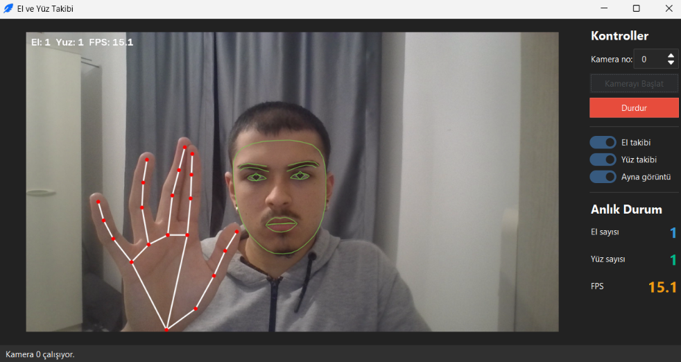

# Real-time Hand & Face Tracking

🇬🇧 English · 🇹🇷 [Türkçe](README.tr.md)

[](https://github.com/alisimsek55/el-yuz-takibi/actions/workflows/tests.yml) [](LICENSE)   

A desktop app that tracks **hand and face landmarks from a webcam in real time**. It uses OpenCV for capture, the **MediaPipe Tasks API** (`HandLandmarker` + `FaceLandmarker`) for detection and a Tkinter + ttkbootstrap GUI. Detection runs on a background thread, so the window stays responsive while the model works.



> The UI is in Turkish: *El* = hand, *Yüz* = face, *Kamerayı Başlat* = start camera, *Durdur* = stop.

## What it does

| Feature | Details |
|---|---|
| **Hand tracking** | Up to 2 hands, 21-point skeleton (joints in red, bones in white) |
| **Face tracking** | Up to 2 faces from MediaPipe's 478-point face mesh, drawn as contours + irises |
| **Independent toggles** | Hand tracking, face tracking and mirror view can each be switched on/off while the camera is running |
| **Live stats** | Hand count, face count and FPS in the side panel and on the video |
| **Camera selection** | Pick the camera index (built-in webcam is usually `0`) |
| **Clear errors** | Missing model files or a camera that fails to open are reported in the status bar instead of crashing |
| **Tests without hardware** | 15 pytest tests cover drawing, coordinate conversion, counting and FPS; they need neither a camera nor the model files |

## How it works

```
Camera.read() ──► Tracker.process() ──► Detections.draw() ──► FPSCounter.tick()
   (BGR frame)     (MediaPipe, VIDEO mode)   (OpenCV drawing)         │
                                                                      ▼
                                      App._refresh() ◄── TrackingWorker.latest()
                                      (Tkinter main loop)  (latest frame, behind a lock)
```

```
src/
├── app.py        # ttkbootstrap GUI + TrackingWorker (background thread)
├── camera.py     # thin cv2.VideoCapture wrapper (DirectShow on Windows)
├── detector.py   # MediaPipe HandLandmarker/FaceLandmarker -> plain Detections
├── drawing.py    # drawing helpers, independent of MediaPipe
├── fps.py        # sliding-window FPS counter
└── models.py     # model paths + download command
tests/            # pytest suite (no camera or models needed)
```

## Engineering highlights

- **Keeping the GUI responsive.** Running two neural networks on every frame on the Tk main thread would freeze the window. Capture, detection and drawing run in a `TrackingWorker` thread; it publishes only the most recent frame behind a lock, and `latest()` hands it over and clears it in one step. The Tk main loop polls with `after()` and is the only code that touches widgets, because Tkinter is not thread-safe. If the worker falls behind, stale frames are simply dropped instead of queuing up.
- **Moving to the MediaPipe Tasks API.** The classic `mp.solutions` API is not available in recent MediaPipe releases, so the app uses `HandLandmarker` and `FaceLandmarker` in `VIDEO` running mode. That mode rejects timestamps that do not strictly increase; the tracker clamps each timestamp to at least `last + 1` ms so two frames read within the same millisecond cannot crash it.
- **Testable without a camera.** `detector.py` converts MediaPipe's landmark objects to plain `(x, y)` tuples at the boundary. Drawing and counting logic therefore never see MediaPipe types, and the tests feed them hand-made points. The FPS counter takes an injectable clock, so its tests are deterministic instead of depending on real time.
- **Readable face overlay.** Drawing all 2,556 tesselation edges of the 478-point mesh turns the face into a green blur. The app draws only the contour and iris connections (lips, eyes, brows, face oval; 132 edges), which is easier to read and about 20× fewer lines per face.
- **Robust drawing.** Normalised landmarks can fall slightly outside the frame (e.g. a hand at the edge); they are clamped to the image bounds, and connections that reference missing points are skipped.
- **Dependency pitfall.** `mediapipe` already installs `opencv-contrib-python`. Installing `opencv-python` as well makes two packages share one `cv2` module and break each other, so `requirements.txt` deliberately leaves it out and says why.

## Running locally

Requirements: Python 3.13 (3.10+ is expected to work) and a webcam. Tested on Windows 10/11.

```bash
git clone https://github.com/alisimsek55/el-yuz-takibi.git
cd el-yuz-takibi
py -3 -m venv .venv
.venv\Scripts\activate          # macOS/Linux: source .venv/bin/activate
pip install -r requirements.txt
```

Download the two MediaPipe models (~11 MB, not committed to the repo) into `models/`:

```bash
python -m src.models
```

| File | Source |
|---|---|
| `models/hand_landmarker.task` | https://storage.googleapis.com/mediapipe-models/hand_landmarker/hand_landmarker/float16/latest/hand_landmarker.task |
| `models/face_landmarker.task` | https://storage.googleapis.com/mediapipe-models/face_landmarker/face_landmarker/float16/latest/face_landmarker.task |

Start the app:

```bash
python -m src.app
```

1. Change **Kamera no** (camera index) if needed.
2. Click **Kamerayı Başlat** (start camera).
3. Use the **El takibi** / **Yüz takibi** / **Ayna görüntü** switches to toggle hand tracking, face tracking and mirror view.
4. Watch the hand/face counts and FPS in the right-hand panel.

## Tests

```bash
python -m pytest
```

The tests run without a camera or model files and also run on every push via GitHub Actions.

## License

[MIT](LICENSE) © 2026 Ali Şimşek
