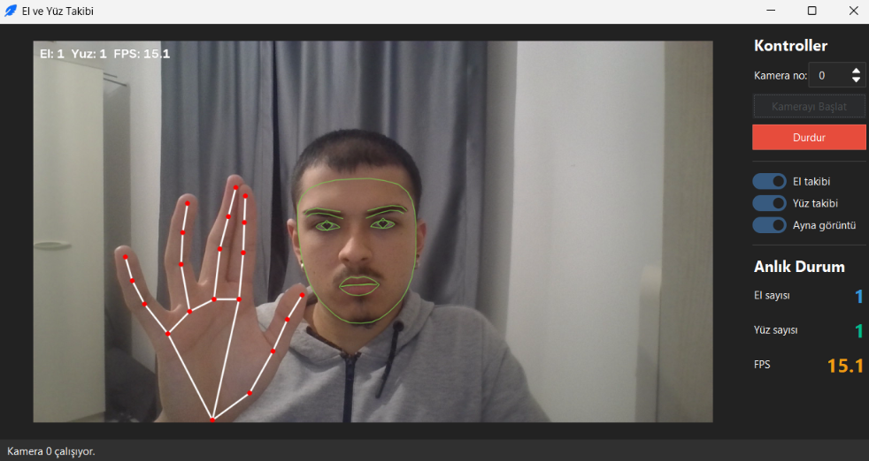

# Gerçek Zamanlı El ve Yüz Takibi

🇬🇧 [English](README.md) · 🇹🇷 Türkçe

[](https://github.com/alisimsek55/el-yuz-takibi/actions/workflows/tests.yml) [](LICENSE)   

Web kamerasından **gerçek zamanlı el ve yüz referans noktası (landmark) takibi** yapan masaüstü uygulaması. Görüntü OpenCV ile alınır, tespit **MediaPipe Tasks API** (`HandLandmarker` + `FaceLandmarker`) ile yapılır, arayüz Tkinter + ttkbootstrap ile yazılmıştır. Tespit arka plan iş parçacığında çalıştığı için model çalışırken pencere donmaz.



## Özellikler

| Özellik | Ayrıntı |
|---|---|
| **El takibi** | 2 ele kadar, 21 noktalı iskelet (eklemler kırmızı, kemikler beyaz) |
| **Yüz takibi** | MediaPipe'ın 478 noktalı yüz ağından 2 yüze kadar; kontur + iris olarak çizilir |
| **Ayrı anahtarlar** | El takibi, yüz takibi ve ayna görüntü kamera çalışırken ayrı ayrı açılıp kapatılabilir |
| **Anlık göstergeler** | El sayısı, yüz sayısı ve FPS hem yan panelde hem görüntü üzerinde |
| **Kamera seçimi** | Kamera numarası seçilebilir (dahili kamera genellikle `0`) |
| **Anlaşılır hatalar** | Eksik model dosyası veya açılamayan kamera, uygulamayı çökertmek yerine durum çubuğunda bildirilir |
| **Donanımsız testler** | 15 pytest testi çizim, koordinat dönüşümü, sayım ve FPS mantığını doğrular; kamera ya da model dosyası gerekmez |

## Nasıl çalışır

```
Camera.read() ──► Tracker.process() ──► Detections.draw() ──► FPSCounter.tick()
   (BGR kare)      (MediaPipe, VIDEO modu)   (OpenCV çizimi)          │
                                                                      ▼
                                      App._refresh() ◄── TrackingWorker.latest()
                                      (Tkinter ana döngüsü)  (kilitli son kare)
```

```
src/
├── app.py        # ttkbootstrap arayüzü + TrackingWorker (arka plan iş parçacığı)
├── camera.py     # cv2.VideoCapture sarmalayıcısı (Windows'ta DirectShow)
├── detector.py   # MediaPipe HandLandmarker/FaceLandmarker -> sade Detections
├── drawing.py    # MediaPipe'tan bağımsız çizim yardımcıları
├── fps.py        # Kayan pencereli FPS ölçer
└── models.py     # Model dosya yolları ve indirme komutu
tests/            # pytest testleri (kamera ve model gerekmez)
```

## Mühendislik notları

- **Arayüzü donmadan tutmak.** Her karede iki sinir ağını Tk ana iş parçacığında çalıştırmak pencereyi dondururdu. Kamera okuma, tespit ve çizim `TrackingWorker` iş parçacığında yapılır; bu iş parçacığı yalnızca en son kareyi bir kilit arkasında paylaşır, `latest()` kareyi tek adımda alıp temizler. Tk ana döngüsü `after()` ile yoklar ve widget'lara dokunan tek koddur, çünkü Tkinter iş parçacığı güvenli değildir. İşçi geride kalırsa eski kareler kuyrukta birikmez, atlanır.
- **MediaPipe Tasks API'ye geçiş.** Klasik `mp.solutions` API'si MediaPipe'ın yeni sürümlerinde yok; bu yüzden `HandLandmarker` ve `FaceLandmarker` `VIDEO` modunda kullanılır. Bu mod kesin artmayan zaman damgalarını reddeder; tracker her damgayı en az `son + 1` ms'ye yükseltir, böylece aynı milisaniyede okunan iki kare uygulamayı çökertmez.
- **Kamerasız test edilebilirlik.** `detector.py`, MediaPipe'ın landmark nesnelerini sınırda sade `(x, y)` çiftlerine çevirir. Çizim ve sayım kodu MediaPipe tiplerini hiç görmez; testler elle yazılmış noktalar verir. FPS ölçer dışarıdan saat alır, bu yüzden testleri gerçek zamana bağlı değil, deterministiktir.
- **Okunaklı yüz çizimi.** 478 noktalı ağın 2.556 kenarlık tam örgüsünü çizmek yüzü yeşil bir lekeye çevirir. Uygulama yalnızca kontur ve iris bağlantılarını (dudaklar, gözler, kaşlar, yüz ovali; 132 kenar) çizer; hem daha okunaklı hem yüz başına yaklaşık 20 kat daha az çizgidir.
- **Sağlam çizim.** Normalize noktalar karenin biraz dışına taşabilir (ör. kenardaki bir el); görüntü sınırına sabitlenir, eksik noktaya işaret eden bağlantılar atlanır.
- **Bağımlılık tuzağı.** `mediapipe` zaten `opencv-contrib-python` kurar. Ayrıca `opencv-python` kurmak iki paketin aynı `cv2` modülünü paylaşıp birbirini bozmasına yol açar; `requirements.txt` bunu bilerek dışarıda bırakır ve nedenini yazar.

## Yerelde çalıştırma

Gereksinimler: Python 3.13 (3.10+ ile de çalışması beklenir) ve bir web kamerası. Windows 10/11 üzerinde denenmiştir.

```bash
git clone https://github.com/alisimsek55/el-yuz-takibi.git
cd el-yuz-takibi
py -3 -m venv .venv
.venv\Scripts\activate          # macOS/Linux: source .venv/bin/activate
pip install -r requirements.txt
```

İki MediaPipe modelini (~11 MB, depoya eklenmez) `models/` klasörüne indirin:

```bash
python -m src.models
```

| Dosya | Kaynak |
|---|---|
| `models/hand_landmarker.task` | https://storage.googleapis.com/mediapipe-models/hand_landmarker/hand_landmarker/float16/latest/hand_landmarker.task |
| `models/face_landmarker.task` | https://storage.googleapis.com/mediapipe-models/face_landmarker/face_landmarker/float16/latest/face_landmarker.task |

Uygulamayı başlatın:

```bash
python -m src.app
```

1. Gerekirse **Kamera no** değerini değiştirin.
2. **Kamerayı Başlat**'a basın.
3. **El takibi** / **Yüz takibi** / **Ayna görüntü** anahtarlarıyla tespitleri ve ayna görüntüyü açıp kapatın.
4. Sağ paneldeki sayaçlardan el/yüz sayısını ve FPS'i izleyin.

## Testler

```bash
python -m pytest
```

Testler kamera ya da model dosyası gerektirmez; her push'ta GitHub Actions üzerinde de çalışır.

## Lisans

[MIT](LICENSE) © 2026 Ali Şimşek
